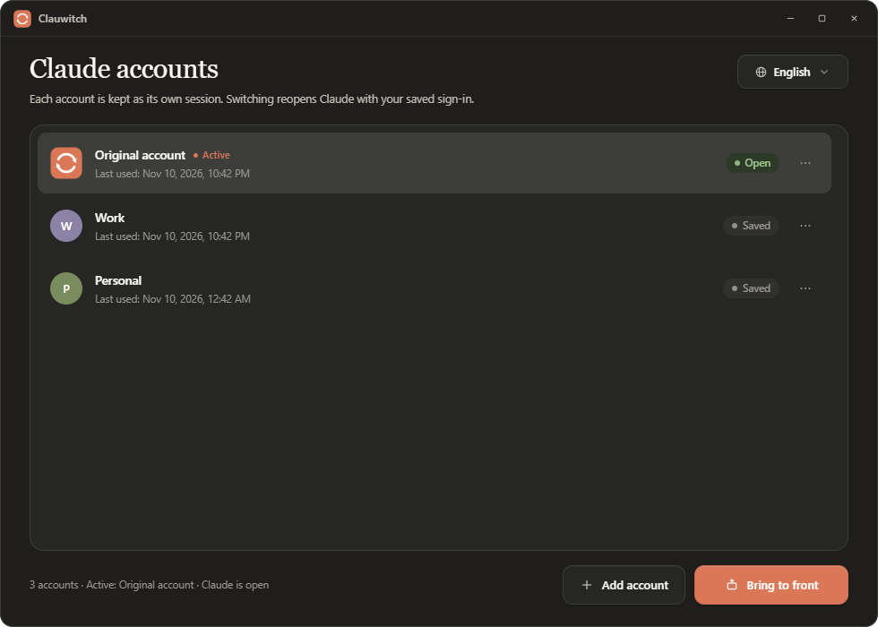
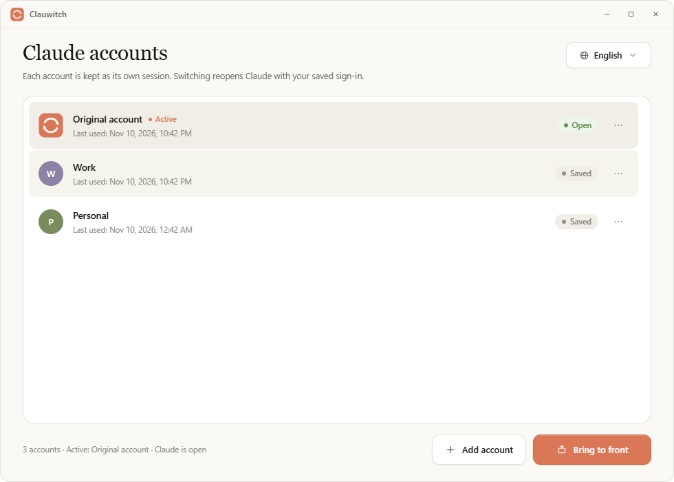
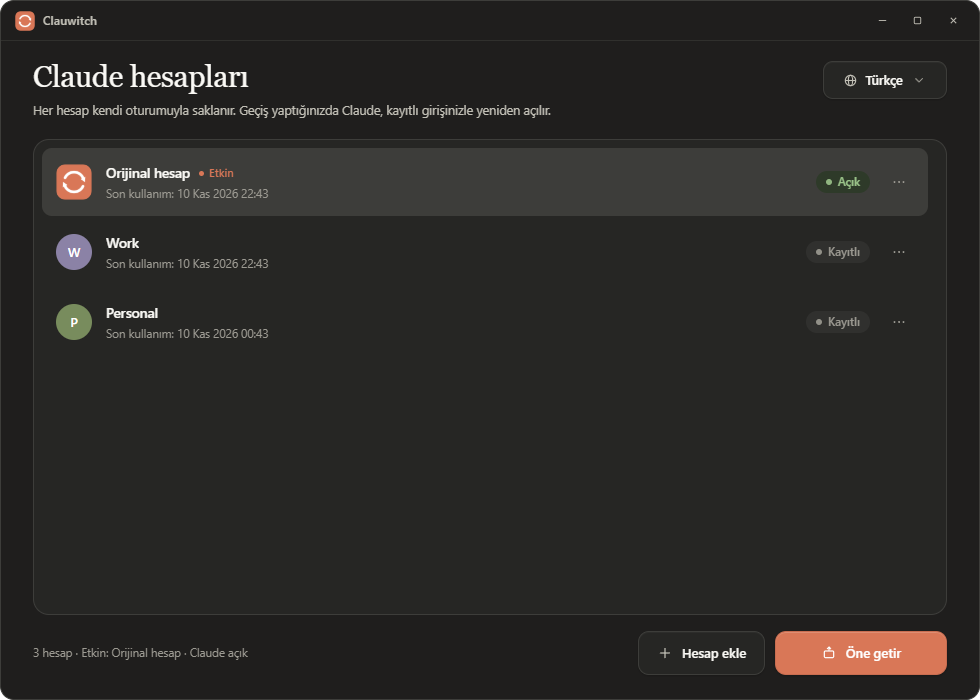

# Clauwitch


[English](README.md) · [Türkçe](README.tr.md)

Switch between multiple Claude Desktop accounts without signing in again. Each account is kept as its own local session; switching closes Claude, swaps the saved session into place, and opens Claude again.



<p align="center">
  
  
</p>

## Features

- **One sign-in per account.** The session is stored on this computer and reused on every switch.
- **Turkish and English interface**, switchable at runtime and remembered.
- **Follows Claude's theme.** The window uses the active account's light or dark preference.
- **Claude-like design.** Ivory, slate and clay palette; serif display type over a sans body.
- **Quick switching.** Pick an account and continue where you left off.
- **Small native app.** Rust + Tauri; no account data leaves your machine.
- **Safety net.** If the app is interrupted during a switch, the next start restores a consistent state.

## How it works

Claude Desktop keeps its session in a data folder. Clauwitch keeps one copy of that folder per account and swaps the active one into place:

| Platform | Claude data (live) | Clauwitch data |
|---|---|---|
| Windows | `%LOCALAPPDATA%\Claude-Data\claude_<package>` (or `%APPDATA%\Claude`) | `%LOCALAPPDATA%\ClauwitchData` |
| macOS | `~/Library/Application Support/Claude` | `~/Library/Application Support/ClauwitchData` |
| Linux | `$XDG_CONFIG_HOME/Claude` (`~/.config/Claude`) | `$XDG_DATA_HOME/ClauwitchData` (`~/.local/share/ClauwitchData`) |

When you switch, the app closes Claude (on Windows it also stops the Cowork VM service if it is running), moves the active data folder to its account slot, moves the target account's folder into the live location, and launches Claude again. The `state.ini` journal makes the operation recoverable.

Only one account is active at a time. Switching closes the running Claude window.

If you used the earlier **Claude Account Switch** build, Clauwitch migrates its settings and profiles to `ClauwitchData` on first launch.

## Requirements

- **Windows 10/11** — Microsoft Edge WebView2 Runtime (preinstalled on Windows 11; the installer fetches it if needed).
- **macOS 11+** — `Claude.app` in `/Applications` or `~/Applications`.
- **Linux** — there is no official Claude Desktop for Linux; Clauwitch works with community builds that install a `claude-desktop` command on `PATH` and store data in `~/.config/Claude`. Tray icon needs `libayatana-appindicator`.
- [Claude Desktop](https://claude.ai/download) installed and opened at least once.

## Install

Download the latest build from [Releases](../../releases):

- Windows: `Clauwitch_x.y.z_x64-setup.exe` (per-user, no admin rights).
- macOS: `Clauwitch_x.y.z_universal.dmg`. Builds are not notarized yet: right-click → **Open** on first launch.
- Linux: `.deb`, `.rpm` or `.AppImage`.
## Usage

1. Open **Clauwitch**.
2. If you have not signed in to Claude yet, sign in once in the Original account.
3. Choose **Add account**, give it a name, and sign in in the Claude window that opens.
4. Select an account and choose **Switch**. Later switches reuse the saved session.
5. Use the row menu (`⋯`) to rename, close Claude, open the account folder, or delete an account.

The first switch moves your existing Claude data into the Original account slot. Keep that in mind if you have a large Claude data folder — the move is local and quick, but it is a move, not a copy.

## Language and appearance

Use the language control in the top-right corner to switch between **Türkçe** and **English**. The choice is saved.

The app reads Claude's own `userThemeMode` setting. If Claude is on its system theme, the app follows the operating system theme. The app uses Claude's documented fallback font stacks: Anthropic Sans/Serif when installed, otherwise Segoe UI and Georgia.

## Data and privacy

The app makes no network requests and does not ask for your Anthropic credentials. Claude's own session files (including the local token cache) stay in the account folders described above. Protect those folders like you would protect your Claude login.

- Settings: `ClauwitchData/settings.ini` (location per platform in the table above)
- Account sessions: `ClauwitchData/profiles`
- Deleted accounts are moved to `ClauwitchData/trash` and cleaned up after seven days.
- Removing the app does not delete account folders. Delete them manually if you want to remove the local sessions.

Back up your Claude data before using any tool that moves it.

## Build from source

Prerequisites (all platforms): Node.js 20+, Rust stable, plus the [Tauri 2 system prerequisites](https://v2.tauri.app/start/prerequisites/):

- **Windows** — Visual Studio Build Tools with *Desktop development with C++*, WebView2.
- **macOS** — Xcode Command Line Tools.
- **Linux (Debian/Ubuntu)** — `sudo apt install libwebkit2gtk-4.1-dev libayatana-appindicator3-dev librsvg2-dev patchelf build-essential`

```bash
npm install
npm run tauri dev      # development
npm run tauri build    # installers under src-tauri/target/release/bundle/
```

Checks run in CI on every push and pull request:

```bash
cd src-tauri && cargo fmt --check && cargo clippy --all-targets -- -D warnings && cargo test
```

Project layout:

```text
src-tauri/src/main.rs            app setup, plugins, command registration
src-tauri/src/commands.rs        Tauri commands called from the UI
src-tauri/src/switcher.rs        add / switch / delete profiles, crash-safe journal
src-tauri/src/settings.rs        settings.ini load/save
src-tauri/src/paths.rs           per-platform data and launcher locations
src-tauri/src/claude.rs          shared Claude process helpers
src-tauri/src/claude_windows.rs  Windows: WMI scan, window messages, Cowork service
src-tauri/src/claude_unix.rs     macOS / Linux: ps, signals, open / osascript
src-tauri/src/tray.rs            system tray menu
src-tauri/tauri.*.conf.json      per-platform bundle settings
ui/                              HTML, CSS and JavaScript interface (no build step)
scripts/                         icon generation helpers
docs/                            screenshots
```

See [CONTRIBUTING.md](CONTRIBUTING.md) before opening a pull request.

## Limitations

- macOS and Linux support is new and less tested than Windows. Please report issues.
- One active account at a time; switching closes the Claude window and interrupts Cowork tasks.
- Uses more disk space as you add accounts, because every account has its own Claude data folder.
- Not affiliated with Anthropic. Claude and Anthropic are trademarks of Anthropic PBC. Use your own accounts and follow Anthropic's terms.

## License

[MIT](LICENSE)
