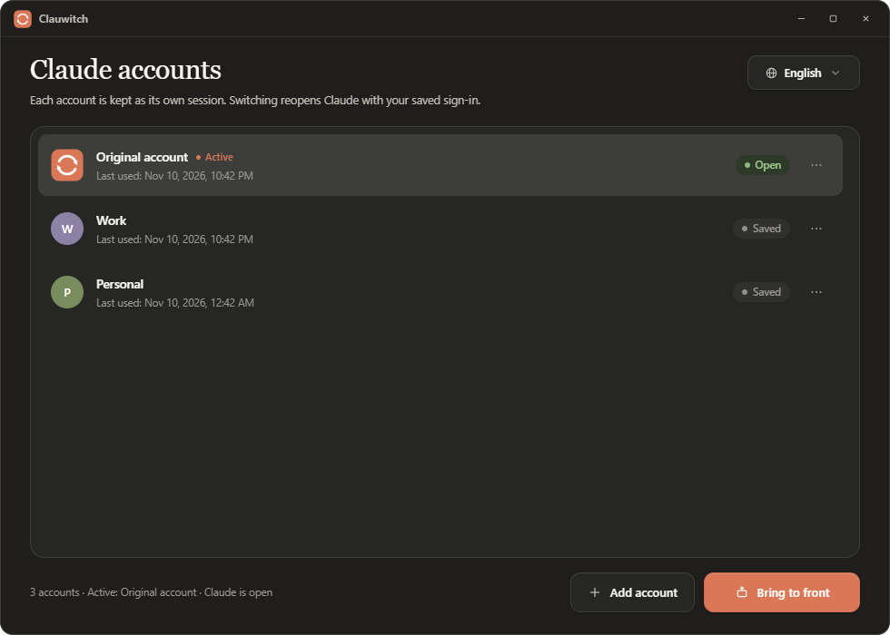

# Clauwitch

[English](README.md) · [Türkçe](README.tr.md)

Claude Desktop'ta birden fazla hesap arasında, her seferinde yeniden giriş yapmadan geçiş yapın. Her hesap kendi yerel oturumuyla saklanır; geçişte uygulama Claude'u kapatır, kayıtlı oturumu yerine taşır ve Claude'u yeniden açar.



## Özellikler

- **Her hesap için tek seferlik giriş.** Oturum bu bilgisayarda saklanır ve sonraki geçişlerde kullanılır.
- **Türkçe ve İngilizce arayüz**; çalışırken değiştirilebilir ve tercih hatırlanır.
- **Claude temasını takip eder.** Etkin hesabın açık veya koyu tema tercihini kullanır.
- **Claude'a yakın tasarım.** Ivory, slate ve clay paleti; serif başlık ve sans gövde.
- **Hızlı geçiş.** Hesabı seçin, kaldığınız yerden devam edin.
- **Küçük ve yerel uygulama.** Rust + Tauri; hesap verileri cihazdan dışarı çıkmaz.
- **Güvenlik ağı.** Geçiş sırasında uygulama kesilirse, bir sonraki açılışta tutarlı duruma dönülür.

## Nasıl çalışır?

Claude Desktop oturumunu şurada tutar:

```text
%LOCALAPPDATA%\Claude-Data\claude_<paket>
```

Uygulama her hesap için bu klasörün bir kopyasını şurada saklar:

```text
%LOCALAPPDATA%\ClauwitchData\profiles
```

Geçiş sırasında Claude kapatılır, gerekirse Cowork VM servisi durdurulur, etkin veri klasörü hesabın klasörüne taşınır, hedef hesabın klasörü canlı konuma getirilir, servis yeniden başlatılır ve Claude açılır. `state.ini` günlüğü işlemin yarıda kalması durumunda toparlanmayı sağlar.

Aynı anda yalnızca bir hesap etkindir. Geçiş, açık Claude penceresini kapatır.

Daha eski **Claude Account Switch** sürümünü kullandıysanız Clauwitch, ayarları ve profilleri ilk açılışta `ClauwitchData` konumuna taşır.

## Gereksinimler

- Windows 10/11, macOS 11+ veya Linux (Linux için `claude-desktop` komutunu sağlayan topluluk Claude Desktop paketi gerekir).
- Kurulum dosyaları ve platform ayrıntıları için İngilizce [README](README.md) sayfasına bakın.
- [Claude Desktop](https://claude.ai/download) kurulu olmalı ve en az bir kez açılmış olmalı.
- Microsoft Edge WebView2 Runtime (Windows 11'de ve çoğu Windows 10 sisteminde kuruludur; gerekirse kurulum sırasında indirilebilir).

## Kurulum

[Releases](../../releases) sayfasından işletim sisteminize uygun kurulum dosyasını (.exe, .dmg, .deb, .rpm, .AppImage) indirip çalıştırın. Kurulum kullanıcı bazlıdır; yönetici izni gerektirmez.

## Kullanım

1. **Clauwitch**'yi açın.
2. Claude'a henüz giriş yapmadıysanız Orijinal hesapta bir kez giriş yapın.
3. **Hesap ekle**'ye tıklayın, bir ad verin ve açılan Claude penceresinde giriş yapın.
4. Bir hesap seçip **Geçiş yap**'a tıklayın. Sonraki geçişler kayıtlı oturumu kullanır.
5. Satır menüsünden (`⋯`) yeniden adlandırabilir, Claude'u kapatabilir, hesap klasörünü açabilir veya hesabı silebilirsiniz.

İlk geçiş, mevcut Claude verinizi Orijinal hesap alanına taşır. Bu yerel bir taşıma işlemidir; kopyalama değildir. Büyük bir Claude veri klasörünüz varsa bunu göz önünde bulundurun.

## Dil ve görünüm

Sağ üstteki dil denetimiyle **Türkçe** ve **English** arasında geçiş yapabilirsiniz. Seçim kaydedilir.

Uygulama Claude'un kendi `userThemeMode` ayarını okur. Claude sistem temasındaysa işletim sistemi temasını izler. Yazı tipleri için Claude'un belgelenen yedek yığınları kullanılır: Anthropic Sans/Serif kuruluysa onlar, değilse Segoe UI ve Georgia.

## Veriler ve gizlilik

Uygulama hiçbir veriyi yüklemez ve Anthropic giriş bilgilerinizi istemez. Claude'un kendi oturum dosyaları (yerel token önbelleği dahil) yukarıdaki hesap klasörlerinde kalır. Bu klasörleri Claude girişiniz kadar koruyun.

- Ayarlar: `%LOCALAPPDATA%\ClauwitchData\settings.ini`
- Hesap oturumları: `%LOCALAPPDATA%\ClauwitchData\profiles`
- Silinen hesaplar `%LOCALAPPDATA%\ClauwitchData\trash` altına taşınır ve yedi gün sonra temizlenir.
- Uygulamanın kaldırılması hesap klasörlerini silmez. Yerel oturumları kaldırmak için bu klasörleri elle silin.

Claude verilerini taşıyan her aracı kullanmadan önce yedek almanız önerilir.

## Kaynaktan derleme

Gereksinimler:

- Node.js 20 veya üzeri.
- Rust stable (MSVC araç zinciri).
- Visual Studio'da **Desktop development with C++** iş yükü ve Windows SDK.
- WebView2 Runtime; Tauri ilk derlemede paketleme araçlarını indirir.

```powershell
npm install
npm run tauri dev      # geliştirme
npm run tauri build    # NSIS kurulum dosyası: src-tauri/target/release/bundle/nsis
```

Proje düzeni:

```text
src-tauri/        Rust backend, Tauri yapılandırması ve ikonlar
src-tauri/src/    ayarlar, Claude süreç/servis kontrolü, profil değiştirici, komutlar
ui/               HTML, CSS ve JavaScript arayüzü
scripts/          ikon üretme yardımcıları
docs/             ekran görüntüleri
```

## Sınırlamalar

- macOS ve Linux desteği yeni; Windows kadar test edilmedi. Sorun görürseniz bildirin.
- Aynı anda tek etkin hesap; geçiş Claude penceresini kapatır ve Cowork görevlerini kesintiye uğratır.
- Hesap ekledikçe disk kullanımı artar; her hesabın kendi Claude veri klasörü vardır.
- Anthropic ile bağlantılı değildir. Claude ve Anthropic, Anthropic PBC'nin ticari markalarıdır. Kendi hesaplarınızı kullanın ve Anthropic koşullarına uyun.

## Lisans

[MIT](LICENSE)
